# UNIDAD V: INGENIERÍA WEB BASADA EN UML (METODOLOGÍA UWE)
## APLICACIÓN WEB ADMINISTRATIVA — JEHOVÁ JIREH MASATEPE MOTO REPUESTOS
**Universidad Nacional de Ingeniería (UNI) — DACTIC**  
**Asignatura:** Ingeniería de Software I | **Docente:** Msc. Juan Francisco Gómez Flores  

---

## 5.2 MODELOS DE DISEÑO UWE APLICADOS A LOS MÓDULOS DEL SISTEMA

La metodología **UWE (UML-based Web Engineering)** propone un proceso de diseño sistemático y dirigido por modelos para aplicaciones hipermedia y web transaccionales. A diferencia de las metodologías de software de escritorio clásicas, UWE separa de forma explícita:
1. **La información del dominio** (Modelo Lógico-Conceptual y de Contenido).
2. **El espacio navegable del usuario** (Modelo de Navegación).
3. **La arquitectura visual de las interfaces** (Modelo de Presentación).
4. **La lógica transaccional de negocio** (Modelo de Procesos).

A continuación se documentan en estricto orden los tres apartados requeridos por módulo:
- **5.2.1 Modelo Lógico-Conceptual** (8 módulos).
- **5.2.2 Modelo de Navegación** (8 módulos, con estereotipos UWE: `«navigationClass»`, `«menu»`, `«index»`, `«query»`, `«processNode»`).
- **5.2.3 Modelo de Presentación** (8 módulos, con estereotipos UWE: `«presentationClass»`, `«presentationGroup»`, `«form»`, `«textInput»`, `«button»`, `«selection»`, `«anchor»`).

---

# 5.2.1 MODELO LÓGICO-CONCEPTUAL

El Modelo Lógico-Conceptual captura la estructura esencial de la información empresarial de **Jehová Jireh Moto Repuestos** de forma independiente de la interfaz web y de la tecnología de implementación, estableciendo clases del dominio, atributos semánticos, cardinalidades y asociaciones.

---

### 5.2.1.1 Gestión de Productos e Inventario
Describe el catálogo de repuestos, su clasificación taxonómica, control físico en bodega y la trazabilidad de entradas, salidas y ajustes de mercadería.

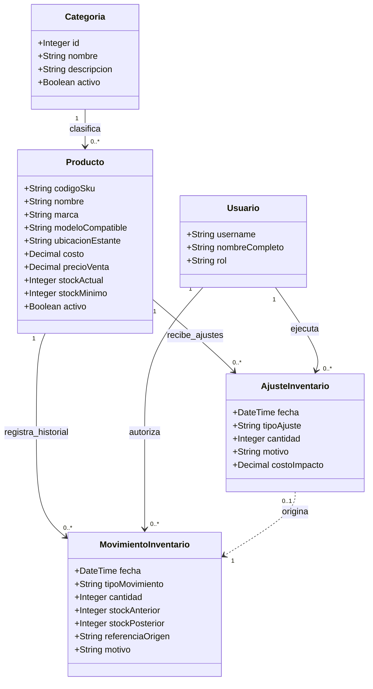

---

### 5.2.1.2 Gestión de Ventas y Caja (Punto de Venta)
Representa la relación entre el turno operativo de caja, la cabecera de la factura de venta, las partidas individuales de repuestos comercializados con su costo histórico, los métodos de cobranza y el tratamiento de devoluciones de clientes.

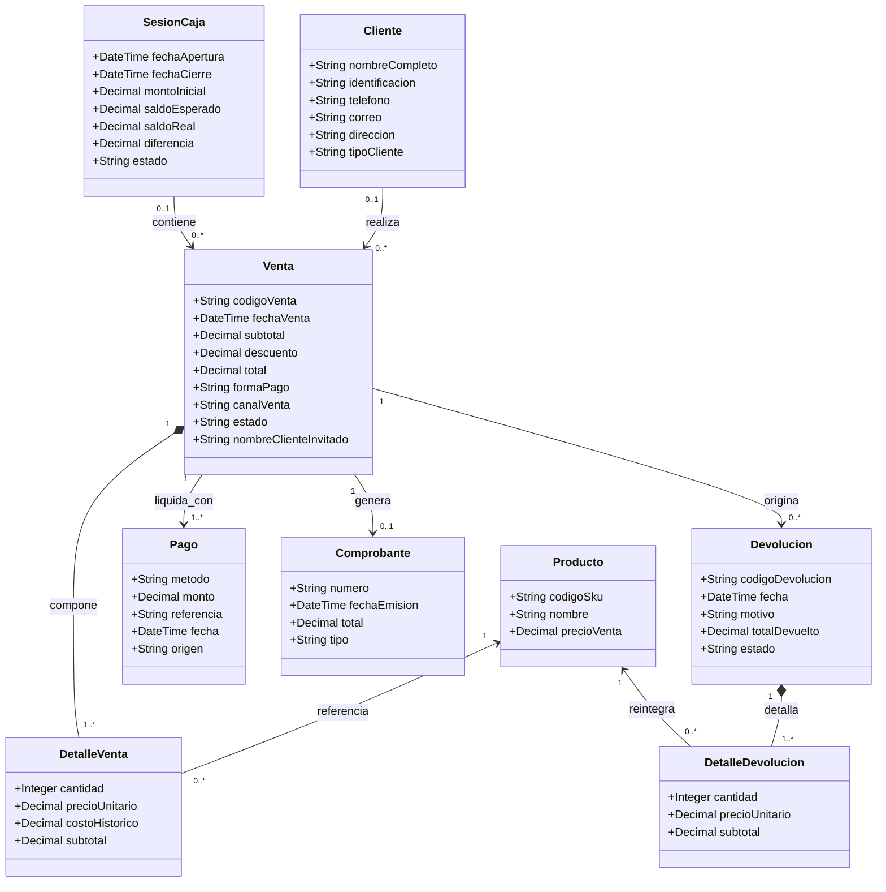

---

### 5.2.1.3 Gestión de Compras y Proveedores
Modela el reabastecimiento de repuestos, contratos con casas comerciales proveedoras, recepción física en bodega e impacto en los costos de adquisición.

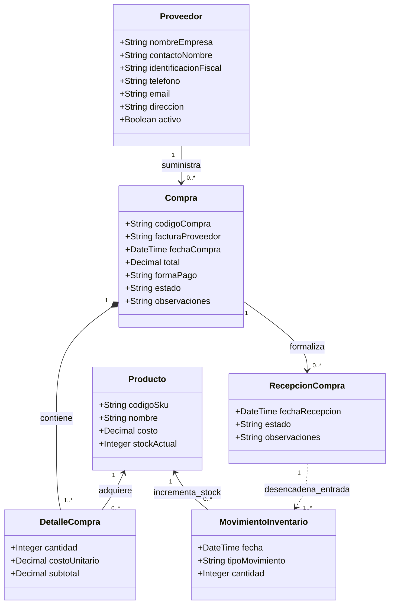

---

### 5.2.1.4 Elaboración de Estados Financieros y Contabilidad
Modela la contabilidad por partida doble, catálogo de cuentas normalizado, asientos contables, conciliación bancaria mensual, estado de flujo de efectivo por actividades (operación, inversión, financiamiento) y módulo fiscal DGI.

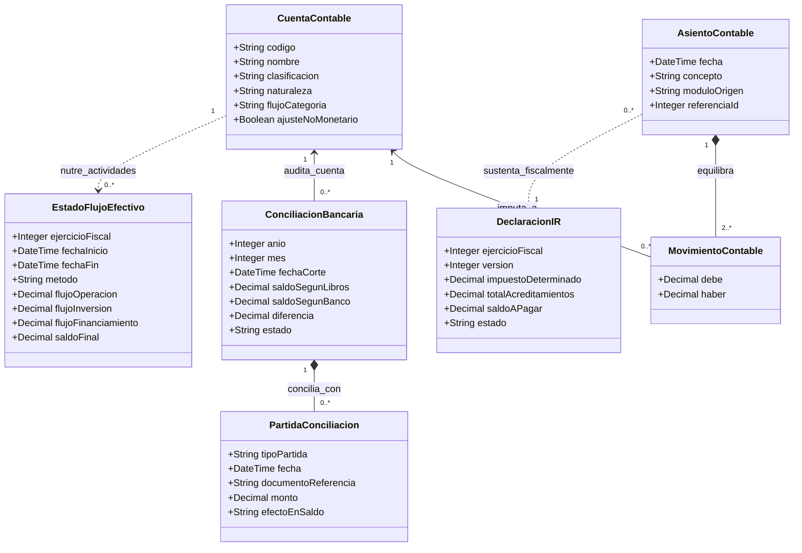

---

### 5.2.1.5 Estadística, Reportes y Análisis
Estructura el motor analítico del negocio que desacopla los filtros de consulta, los KPIs de desempeño, la rotación de existencias ABC (inversión vs consumo) y las medidas estadísticas descriptivas.

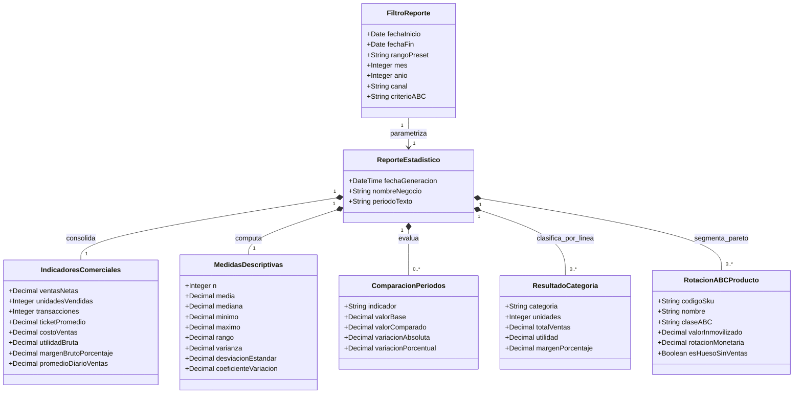

---

### 5.2.1.6 Gestión de Recursos Humanos y Nómina
Representa la administración de colaboradores, contratos bajo legislación nicaragüense (Código del Trabajo Ley 185), control de asistencia, cálculo quincenal de nómina con INSS laboral/patronal, IR según tarifa progresiva DGI e higiene y seguridad laboral (Ley 618).

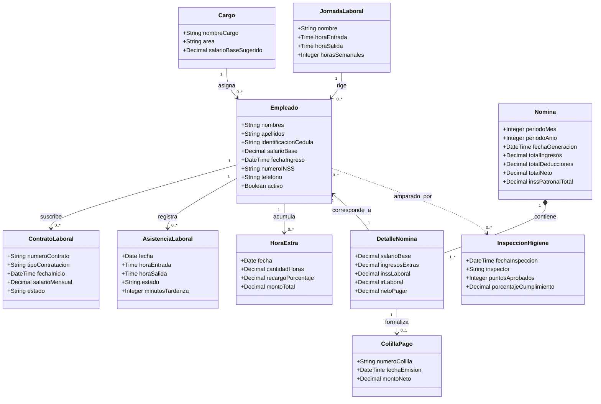

---

### 5.2.1.7 Portal Web y Catálogo Público (Comercio Electrónico)
Modela la navegación externa de clientes, catálogo público con precios comerciales, carrito de compras persistente, colocación de pedidos web y métodos de entrega (retiro en tienda Masatepe o envío).

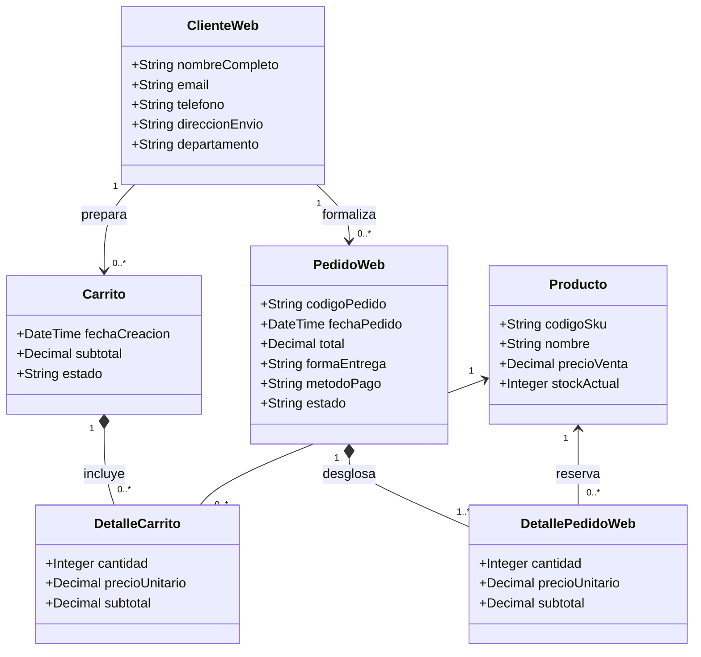

---

### 5.2.1.8 Gestión de Usuarios y Seguridad
Modela el control de acceso basado en roles (RBAC), credenciales de autenticación, sesiones y auditoría de operadores dentro del sistema.

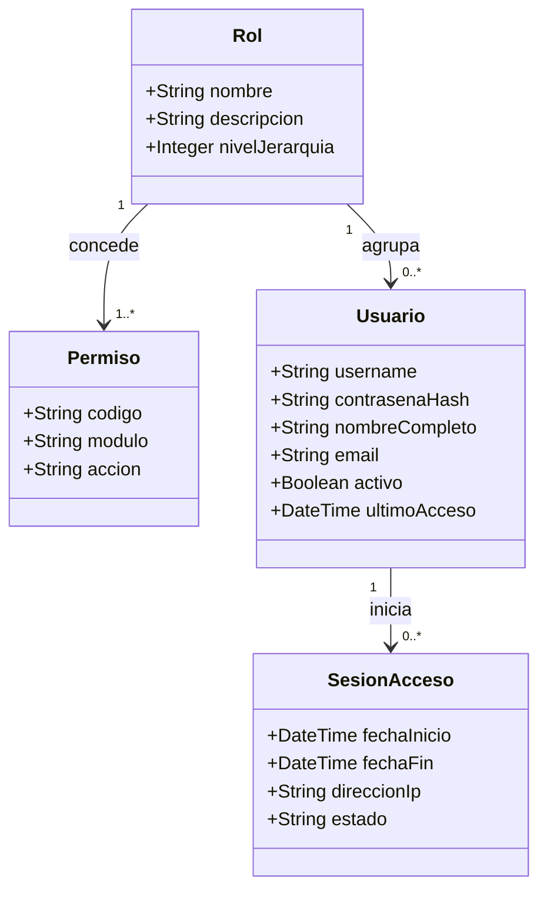

---

# 5.2.2 MODELO DE NAVEGACIÓN

El Modelo de Navegación en UWE describe el hiperespacio y los recorridos disponibles para los usuarios en la aplicación web. Emplea los siguientes estereotipos normativos:
- `«navigationClass»`: Nodo o página de destino navegable.
- `«menu»`: Agrupador contextual de accesos y opciones de navegación.
- `«index»`: Lista o catálogo de enlaces que apuntan a instancias de una clase navegable.
- `«query»`: Formulario de consulta, búsqueda o filtrado de información.
- `«processNode»`: Nodo que desencadena la ejecución de un proceso de negocio transaccional.
- `«navigationLink»`: Enlace dirigido entre nodos navegables.

---

### 5.2.2.1 Navegación de Productos e Inventario
Recorrido para consultar el catálogo de repuestos, aplicar filtros por categoría o texto, revisar existencias y ejecutar operaciones de ajuste y consulta del Kardex.

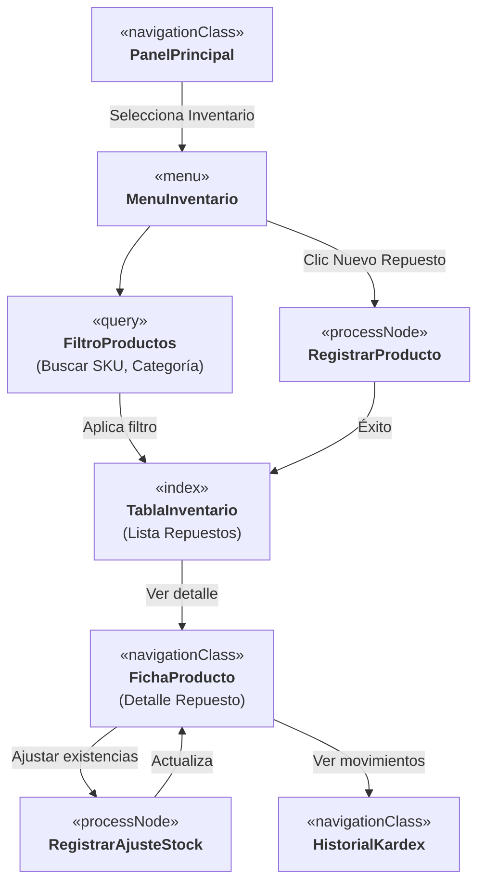

---

### 5.2.2.2 Navegación de Ventas y Caja (Punto de Venta)
Recorrido del cajero/vendedor desde la apertura de turno, selección ágil de repuestos, cálculo de totales, liquidación y emisión del comprobante.

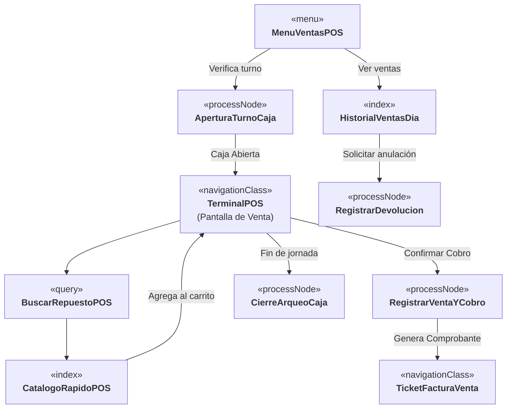

---

### 5.2.2.3 Navegación de Compras y Proveedores
Rutas para registrar órdenes de compra de repuestos a proveedores mayoristas, recepcionar mercadería y verificar el ingreso en bodega.

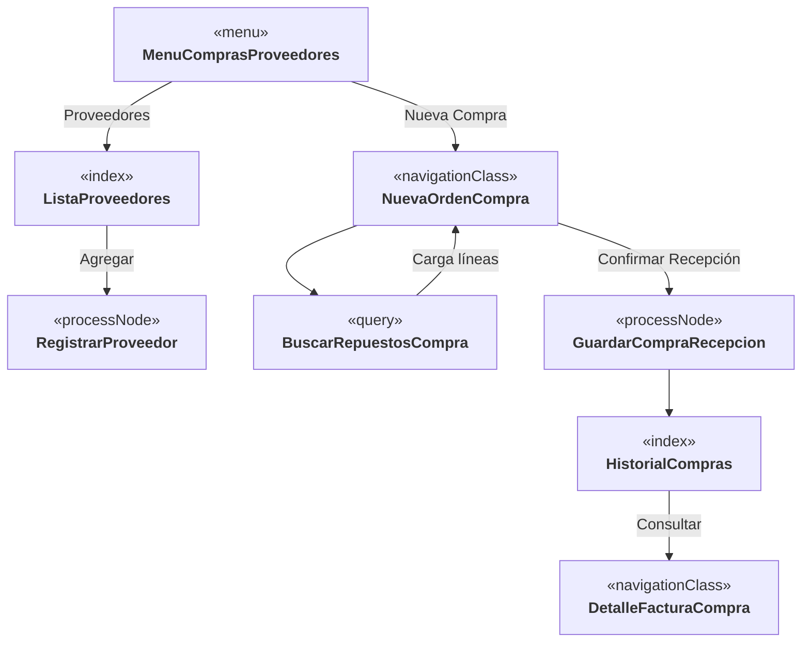

---

### 5.2.2.4 Navegación de Estados Financieros y Contabilidad
Estructura de navegación para contabilidad formal, consulta de libros, balance, resultados, conciliación bancaria y flujo de efectivo.

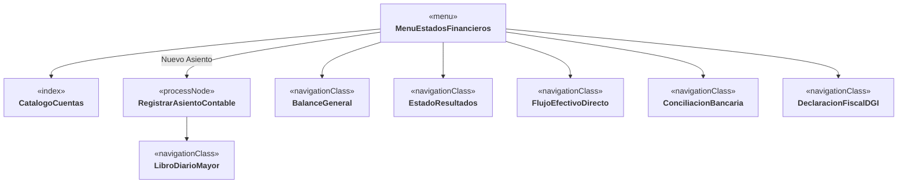

---

### 5.2.2.5 Navegación de Estadística, Reportes y Análisis
Recorrido navegable del módulo analítico, gobernado por la barra de filtrado temporal dinámico y las 7 sub-pestañas de visualización gerencial.

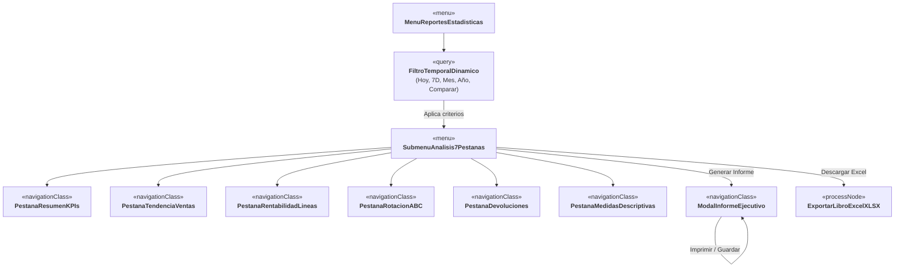

---

### 5.2.2.6 Navegación de Recursos Humanos y Nómina
Navegación para el control de personal, expediente laboral, registro de horas extras/asistencias, formulación de nóminas y colillas de pago.

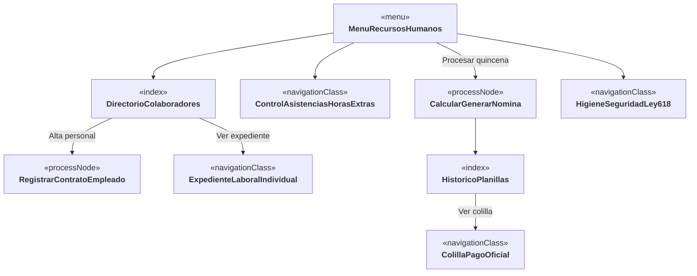

---

### 5.2.2.7 Navegación de Portal Web y Catálogo Público
Espacio navegable de cara al cliente web para descubrir repuestos de motos, consultar especificaciones técnicas, gestionar su carrito y formalizar pedidos.

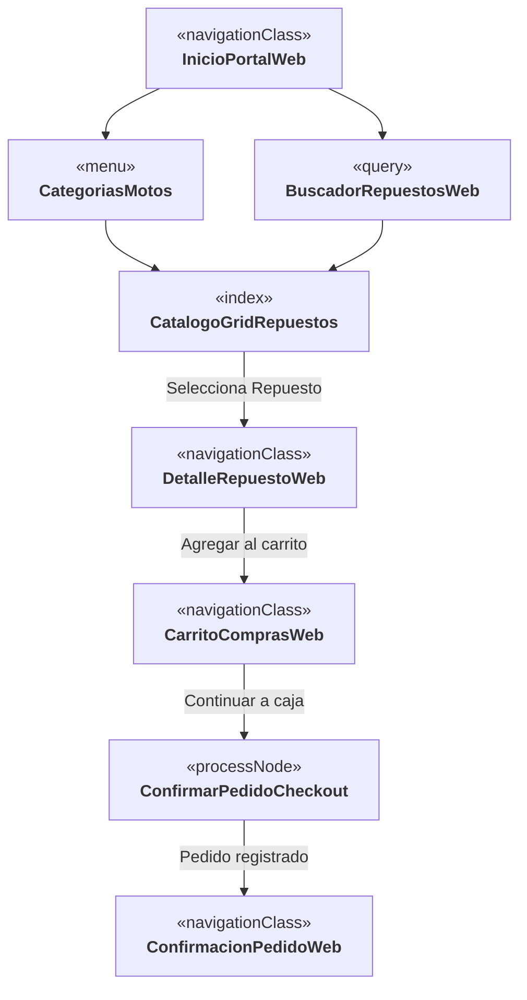

---

### 5.2.2.8 Navegación de Usuarios y Seguridad
Navegación para la administración de credenciales, asignación de perfiles y monitoreo de accesos.

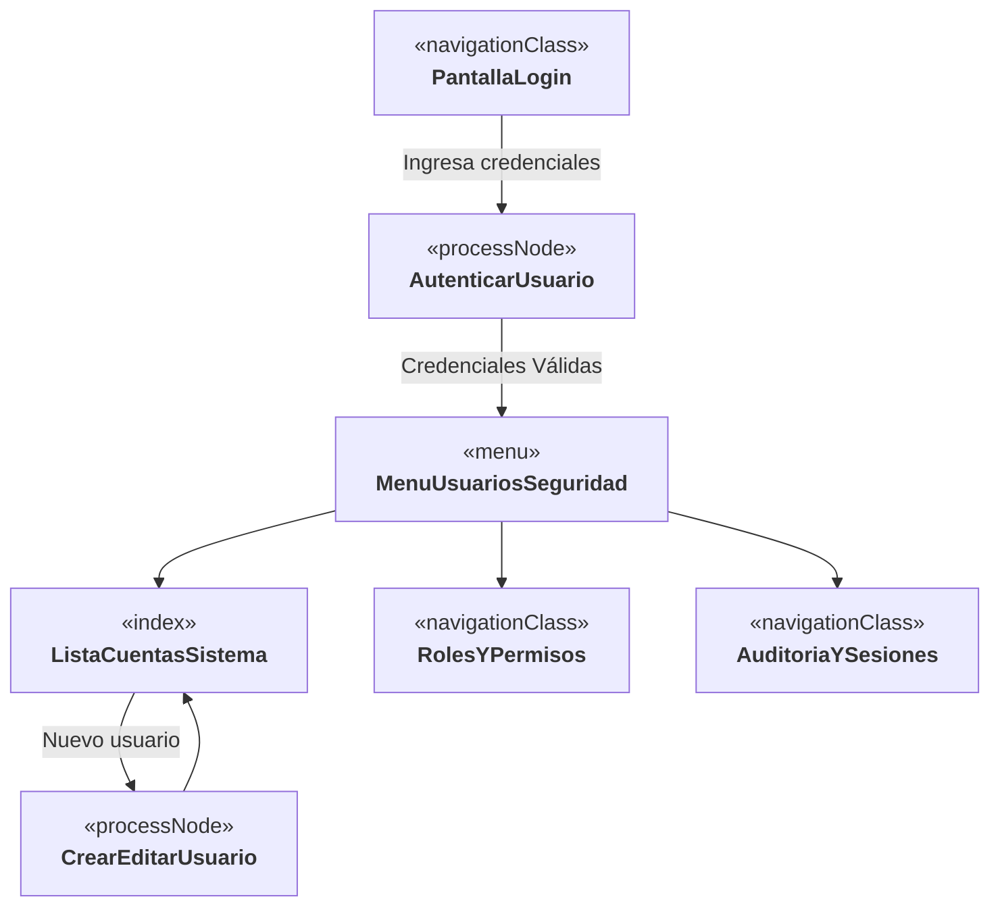

---

# 5.2.3 MODELO DE PRESENTACIÓN

El Modelo de Presentación en UWE describe la arquitectura visual y los componentes interactivos de las interfaces de usuario. Utiliza los siguientes estereotipos normativos:
- `«presentationClass»`: Representa la pantalla o página web completa.
- `«presentationGroup»`: Contenedores lógicos (paneles, tarjetas, barras de herramientas o ventanas modales).
- `«form»`: Formulario estructurado para captura o filtrado de datos.
- `«text»`: Texto informativo, etiquetas o datos de sólo lectura.
- `«textInput»`: Campos de entrada de datos (cajas de texto, fechas, números).
- `«selection»`: Controles de selección múltiple o listas desplegables (dropdowns, selects).
- `«button»`: Botones de comando o ejecución de acciones.
- `«anchor»`: Hipervínculos o pestañas de navegación.
- `«image»`: Elementos visuales, fotografías de repuestos o gráficos estadísticos generados.

---

### 5.2.3.1 Presentación de Productos e Inventario
Representa la interfaz `IU_GestionInventario` con buscador reactivo, alertas visuales de existencias mínimas y modal de registro de repuesto.

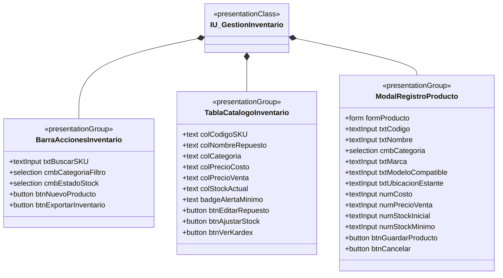

---

### 5.2.3.2 Presentación de Ventas y Caja (Punto de Venta)
Representa la interfaz `IU_PuntoDeVenta` con panel de búsqueda rápida, detalle del ticket en córdobas, panel de cobro y ventana emergente de impresión de factura.

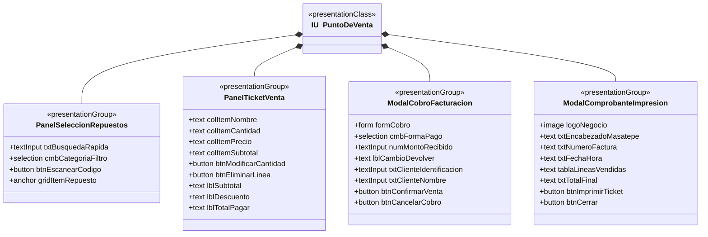

---

### 5.2.3.3 Presentación de Compras y Proveedores
Representa la interfaz `IU_GestionCompras` para el registro de adquisición de repuestos, cálculo de costos e historial de recepciones.

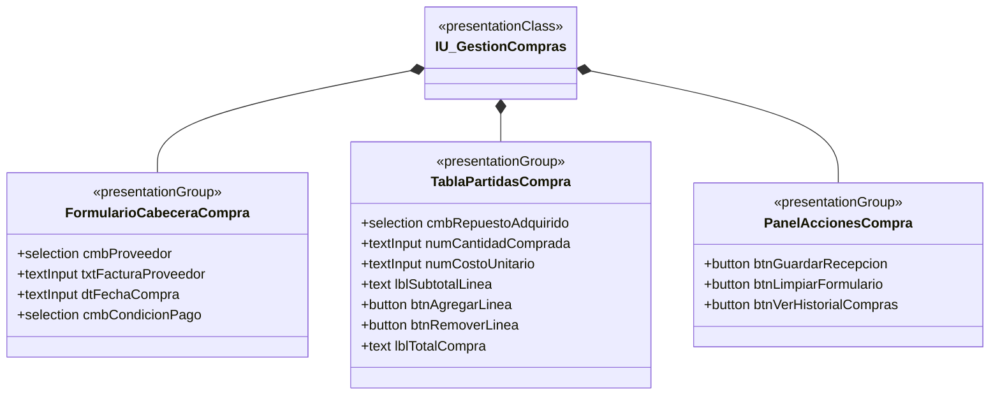

---

### 5.2.3.4 Presentación de Estados Financieros
Representa la interfaz `IU_EstadosFinancieros` con selector de fechas, pestañas contables y tablas de saldos.

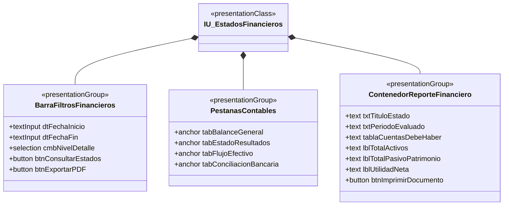

---

### 5.2.3.5 Presentación de Estadística, Reportes y Análisis
Representa la interfaz `IU_EstadisticasYReportes` con la barra de filtrado temporal dinámico, tarjetas de KPIs, gráficos estadísticos y modal de Informe Ejecutivo.

```mermaid
classDiagram
    class IU_EstadisticasYReportes {
        <<presentationClass>>
    }
    class BarraFiltrosTemporales {
        <<presentationGroup>>
        +button btnPresetHoy
        +button btnPreset7Dias
        +button btnPresetMesActual
        +button btnPresetAnio
        +button btnPresetHistorico
        +textInput dtInicioPersonalizado
        +textInput dtFinPersonalizado
        +selection cmbMesDirecto
        +selection cmbAnioDirecto
        +button btnToggleComparar
        +selection cmbCategoriaFiltro
        +selection cmbCanalVentaFiltro
    }
    class TarjetasKPIsIndicadores {
        <<presentationGroup>>
        +text cardVentasNetas
        +text cardUnidadesVendidas
        +text cardTransacciones
        +text cardTicketPromedio
        +text cardUtilidadBruta
        +text cardMargenPorcentaje
        +text badgeVariacionPeriodo
    }
    class NavegacionSubpestanas {
        <<presentationGroup>>
        +anchor tabResumenGeneral
        +anchor tabVentasTendencias
        +anchor tabRentabilidadLineas
        +anchor tabInventarioABC
        +anchor tabDevoluciones
        +anchor tabMedidasDescriptivas
        +anchor tabInformesOficiales
    }
    class PanelGraficosYTablas {
        <<presentationGroup>>
        +image chartTendenciaCronologica
        +image chartDistribucionCategorias
        +image chartMetodosPago
        +text tablaRotacionABC
        +text tablaRepuestosSinMovimiento
        +text tablaAlertasStockCritico
    }
    class ModalInformeEjecutivo {
        <<presentationGroup>>
        +image logoEmpresaMasatepe
        +text txtEncabezadoInforme
        +text txtPeriodoAnalizado
        +text tablaResumenEjecutivo
        +text txtMedidasEstadisticas
        +button btnImprimirInformePDF
        +button btnDescargarExcelXLSX
        +button btnCerrarModal
    }

    IU_EstadisticasYReportes *-- BarraFiltrosTemporales
    IU_EstadisticasYReportes *-- TarjetasKPIsIndicadores
    IU_EstadisticasYReportes *-- NavegacionSubpestanas
    IU_EstadisticasYReportes *-- PanelGraficosYTablas
    IU_EstadisticasYReportes *-- ModalInformeEjecutivo
```

---

### 5.2.3.6 Presentación de Recursos Humanos y Nómina
Representa la interfaz `IU_RecursosHumanos` con gestión de personal, cálculo de planilla e impresión de colillas.

```mermaid
classDiagram
    class IU_RecursosHumanos {
        <<presentationClass>>
    }
    class SubmenuRRHH {
        <<presentationGroup>>
        +anchor tabDirectorioPersonal
        +anchor tabAsistenciasHorasExtras
        +anchor tabPlanillaNomina
        +anchor tabHigieneSeguridad
    }
    class PanelGestionNomina {
        <<presentationGroup>>
        +selection cmbMesNomina
        +selection cmbAnioNomina
        +button btnProcesarCalculoNomina
        +text tablaDetallePlanilla
        +text colEmpleadoNombre
        +text colSalarioBase
        +text colHorasExtras
        +text colINSSLaboral
        +text colIRLaboral
        +text colNetoAPagar
        +button btnVerColillaIndividual
    }
    class ModalColillaImprimible {
        <<presentationGroup>>
        +image logoJehovaJireh
        +text txtDatosTrabajador
        +text txtPeriodoQuincenal
        +text tablaIngresosDeducciones
        +text txtFirmaRecibido
        +button btnImprimirColilla
    }

    IU_RecursosHumanos *-- SubmenuRRHH
    IU_RecursosHumanos *-- PanelGestionNomina
    IU_RecursosHumanos *-- ModalColillaImprimible
```

---

### 5.2.3.7 Presentación de Portal Web y Catálogo Público
Representa la interfaz `IU_PortalWebPublico` para clientes en línea, con grid de repuestos y flujo de compra.

```mermaid
classDiagram
    class IU_PortalWebPublico {
        <<presentationClass>>
    }
    class HeaderNavbarPublico {
        <<presentationGroup>>
        +image logoPortal
        +textInput txtBuscadorRepuestos
        +selection cmbMarcaModeloMoto
        +anchor btnVerCarritoBadge
    }
    class GridCatalogoProductos {
        <<presentationGroup>>
        +image imgRepuestoMoto
        +text txtNombreRepuesto
        +text txtMarcaRepuesto
        +text txtPrecioCordobas
        +text badgeDisponibilidad
        +button btnAgregarAlCarrito
    }
    class DrawerCarritoCheckout {
        <<presentationGroup>>
        +text listaItemsCarrito
        +text lblTotalPagar
        +textInput txtNombreContacto
        +textInput txtTelefonoWhatsApp
        +selection cmbModalidadEntrega
        +textInput txtDireccionEnvio
        +button btnFinalizarPedidoWeb
    }

    IU_PortalWebPublico *-- HeaderNavbarPublico
    IU_PortalWebPublico *-- GridCatalogoProductos
    IU_PortalWebPublico *-- DrawerCarritoCheckout
```

---

### 5.2.3.8 Presentación de Usuarios y Seguridad
Representa la interfaz `IU_UsuariosSeguridad` para la gestión de operadores del sistema.

```mermaid
classDiagram
    class IU_UsuariosSeguridad {
        <<presentationClass>>
    }
    class PanelControlUsuarios {
        <<presentationGroup>>
        +button btnCrearNuevoUsuario
        +selection cmbFiltroRol
        +text tablaCuentasUsuario
        +text colUsername
        +text colNombreCompleto
        +text colRolAsignado
        +text colEstadoActivo
        +button btnEditarUsuario
        +button btnDesactivarUsuario
    }
    class ModalFormularioUsuario {
        <<presentationGroup>>
        +form formUsuario
        +textInput txtUsername
        +textInput txtPasswordCredencial
        +textInput txtNombreCompleto
        +textInput txtCorreo
        +selection cmbRolSistema
        +button btnGuardarCuenta
        +button btnCancelar
    }

    IU_UsuariosSeguridad *-- PanelControlUsuarios
    IU_UsuariosSeguridad *-- ModalFormularioUsuario
```

---

## RESUMEN DE COBERTURA UWE EN EL PROYECTO

| N° | Módulo del Sistema | 5.2.1 Modelo Lógico-Conceptual | 5.2.2 Modelo de Navegación | 5.2.3 Modelo de Presentación |
| :---: | :--- | :---: | :---: | :---: |
| **1** | Productos e Inventario | Completado | Completado | Completado |
| **2** | Ventas y Caja (POS) | Completado | Completado | Completado |
| **3** | Compras y Proveedores | Completado | Completado | Completado |
| **4** | Estados Financieros y Contabilidad | Completado | Completado | Completado |
| **5** | Estadística, Reportes y Análisis | Completado | Completado | Completado |
| **6** | Recursos Humanos y Nómina | Completado | Completado | Completado |
| **7** | Portal Web y Catálogo Público | Completado | Completado | Completado |
| **8** | Usuarios y Seguridad | Completado | Completado | Completado |
